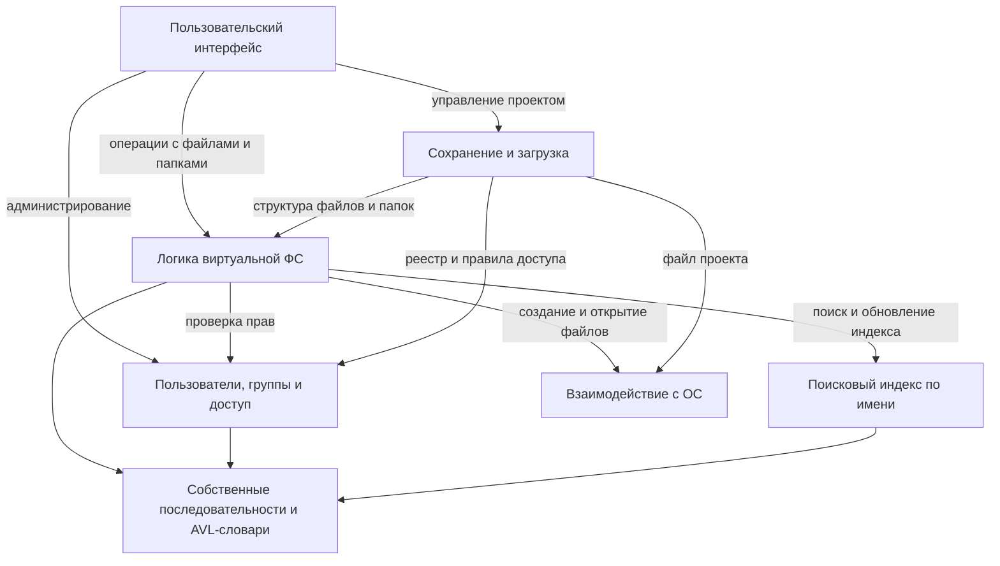

## I. Постановка задачи

#### 1. Что разрабатывается

Виртуальная файловая система для организации файлов в папки, поиска по имени и управления доступом.

#### 2. Зачем нужна программа

Упорядочивание файлов независимо от их физического расположения, упрощение поиска и разграничение доступа.

#### 3. Где применяется

В системах управления файловыми ресурсами и совместной работы с ними.

## II. Сущности прикладной задачи

#### 1. Сущности

- **Файл** — именованная ссылка на реальный файл.
- **Папка** — объединяет файлы и вложенные папки.
- **Пользователь** — выполняет действия в пределах своих разрешений.
- **Группа** — объединяет пользователей для назначения общих прав.
- **Правило доступа** — задаёт группе чтение и запись для файла или папки.

#### 2. Связи

- Каждый файл и каждая папка, кроме корневой, имеют одну родительскую папку.
- Пользователь может состоять в нескольких группах
- Группа включает нескольких пользователей.
- Права групп объединяются и могут наследоваться от родительской папки.

## III. Архитектура

#### 1. Компоненты

- **GUI** — навигация, ввод команд и отображение результатов.
- **Логика виртуальной ФС** — операции с файлами и папками, контроль структуры.
- **Пользователи и доступ** — группы, членство и проверка разрешений.
- **Поисковый индекс** — поиск файлов по имени.
- **Сохранение и загрузка** — запись и восстановление проекта.
- **Библиотека структур данных** — собственные последовательности и AVL-словари.
- **Взаимодействие с ОС** — создание и открытие реальных файлов.

#### 2. Взаимодействие

GUI передаёт команды прикладной логике. Логика проверяет права, изменяет структуру и обновляет индекс. Сохранение объединяет структуру ФС и реестр пользователей в один снимок.

#### 3. Структуры данных и алгоритмы

- Сведения о файлах и папках хранятся по устойчивым идентификаторам; содержимое папки — в собственной последовательности.
- Индекс хранит соответствие **имя файла → последовательность идентификаторов**. Это позволяет находить одноимённые файлы из разных папок.
- AVL-дерево используется для словарей. Иерархия папок существует отдельно от поискового дерева.
- Путь строится по цепочке родителей; циклы проверяются перед перемещением.
- Удаление папки выполняется обходом поддерева после проверки прав на всё его содержимое.
- После загрузки индекс восстанавливается из виртуальной структуры.

## IV. Функциональные требования

#### 1. Файлы и папки

- Создание папок, подключение существующих файлов и создание новых пустых файлов без перезаписи существующих.
- Просмотр содержимого и путей; открытие файла во внешней программе.
- Переименование, перемещение, в том числе перетаскиванием, и удаление с подтверждением.
- Рекурсивное удаление папки; сохранение физических оригиналов при виртуальных операциях.
- Запрет изменения корня, циклического перемещения, некорректных и повторяющихся в одной папке имён.
- Выбор значка файла; действия через кнопки и контекстное меню.

#### 2. Поиск

- Точный поиск по полному имени с расширением во всём проекте, с учётом регистра.
- Вывод всех доступных совпадений с виртуальными путями; открытие файла или переход в его папку.
- Обновление индекса после изменений; сообщение при отсутствии результатов.

#### 3. Пользователи и доступ

- Создание и переименование пользователей и групп, изменение членства администратором.
- Назначение группам чтения и записи; включение и отключение наследования.
- Объединение разрешений групп и унаследованных правил. При отключении наследования учитываются только локальные правила; явных запретов нет.
- Просмотр и поиск требуют чтения файла или папки и всех её родителей.
- Создание требует записи в целевую папку; переименование и удаление — записи на изменяемый файл или папку и её родителя.
- Перемещение требует записи на перемещаемый файл или папку, исходную и целевую папки. Наследуемые права определяются новым расположением.
- Администратор имеет полный доступ; переключение пользователей служит демонстрации прав без паролей.

#### 4. Сохранение состояния

- Один файл проекта хранит структуру, идентификаторы, физические пути, значки, пользователей, группы и права. Содержимое оригиналов не копируется.
- Ручное сохранение и загрузка доступны администратору.
- Автосохранение обновляет основной файл каждые 30 секунд при наличии изменений и при закрытии; путь выбирается первым ручным сохранением. Автосохранение можно отключить.
- При несохранённых изменениях доступны сохранение, отказ от сохранения и отмена. Таймер ожидает решения пользователя.
- Ошибки загрузки или записи сохраняют текущее состояние и предыдущий корректный файл проекта. Перезапись подключённого оригинала файлом проекта запрещается.

#### 5. Интерфейс и ошибки

- Дерево папок, таблица содержимого, поиск, переключение пользователя и администрирование.
- Тёмная тема, минималистичные значки, отображение состояния сохранения.
- Понятные сообщения о неверных данных, недостатке прав и недоступных физических файлах; недоступные действия отключаются.

## V. Нефункциональные требования

#### 1. Ограничения

- C++20, Qt Widgets, сборка CMake.
- Собственные контейнеры; прикладные алгоритмы тестируются независимо от GUI.
- Права действуют внутри приложения; дисковое размещение данных и права ОС не изменяются.

#### 2. Надёжность

- Уникальность идентификаторов, отсутствие циклов, согласованность иерархии и индекса.
- Проверка аргументов и прав до изменения данных; корректное освобождение ресурсов.
- Проверка загружаемых данных до замены текущего проекта.

#### 3. Эффективность

- Поиск, вставка и удаление ключа в AVL-словаре — `O(log N)`; обход — `O(N)`.
- Выдача совпадений, проверка прав и построение путей требуют дополнительной обработки.

*N — количество ключей в рассматриваемом словаре.

## VII. Сравнение AVL и BST

| Критерий | Обычное BST | AVL-дерево |
|---|---|---|
| Балансировка | Не поддерживается автоматически | Поддерживается при изменениях |
| Высота в худшем случае | `O(N)` | `O(log N)` |
| Поиск, вставка, удаление в худшем случае | `O(N)` | `O(log N)` |
| Построение последовательными вставками отсортированных ключей | `O(N²)` | `O(N log N)` |
| Обход | `O(N)` | `O(N)` |
| Особенность | Проще, но зависит от формы дерева | Требует поддержания баланса, обеспечивает предсказуемую сложность |

*N — количество различных ключей. Построение рассматривается для изначально пустого дерева.*

**Выбор:** AVL-дерево обеспечивает логарифмическую сложность индексных операций независимо от порядка поступления имён.
